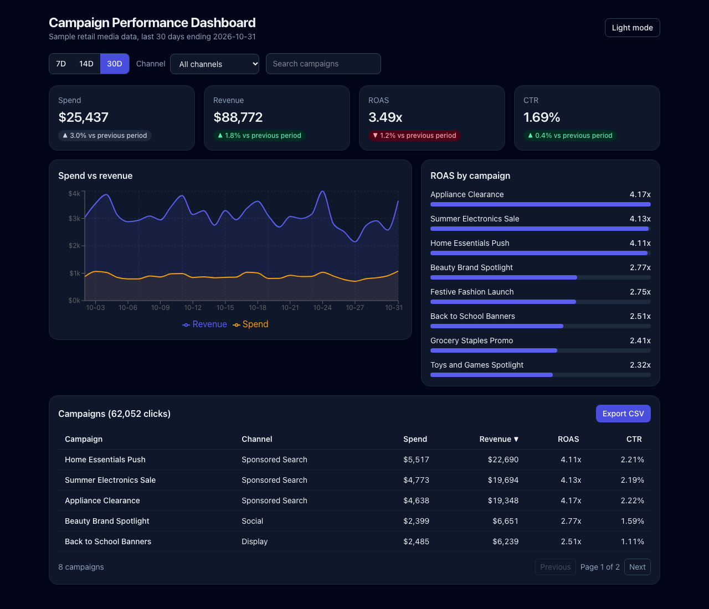

# Campaign Performance Dashboard

A responsive analytics dashboard for retail media campaigns, built with React, TypeScript and Tailwind CSS.



**Live demo:** https://shreybillade3-hub.github.io/campaign-performance-dashboard/

> The data is a **sample dataset generated locally** with a seeded random number generator (see `src/data/campaigns.ts`). It does not come from any real advertiser or retailer.

## Features

- KPI cards for spend, revenue, ROAS and CTR, each compared against the previous period of the same length
- Date range (7, 14 or 30 days), channel and campaign-name filters
- Spend vs revenue trend chart (Recharts) and a ROAS ranking by campaign
- Sortable, paginated campaign table with accessible `aria-sort` states
- CSV export of the filtered table
- Light and dark theme, saved in `localStorage`, defaulting to the system preference
- Mobile-first layout, keyboard focus styles and semantic HTML

## Tech stack

React 19, TypeScript, Vite, Tailwind CSS v4, Recharts, Vitest, React Testing Library, GitHub Actions

## Project structure

```
src/
  components/   KpiCard, Filters, TrendChart, RoasChart, CampaignTable, ThemeToggle
  data/         seeded sample dataset
  hooks/        useTheme
  lib/          metrics (pure calculations), csv
  types.ts      shared types
```

Business logic (ROAS, CTR, period windows, sorting) lives in `src/lib/metrics.ts` as pure functions, so it is tested without rendering anything.

## Getting started

```bash
npm install
npm run dev       # start the dev server
npm test          # run the test suite
npm run lint
npm run build
```

## Testing

Vitest and React Testing Library cover the metric calculations, CSV escaping, table pagination and sorting, and the filtering and theme behavior of the full app.

## What I learned

Separating calculations from UI, comparing time windows correctly, and building accessible sortable tables.
